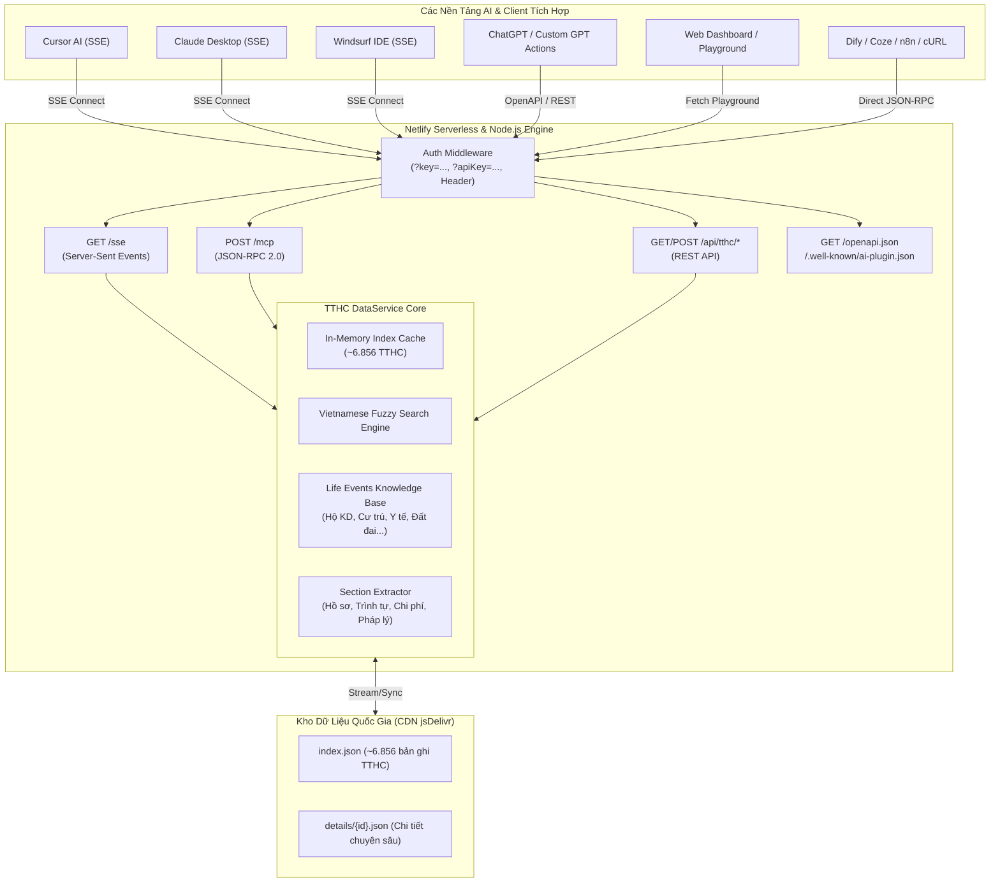
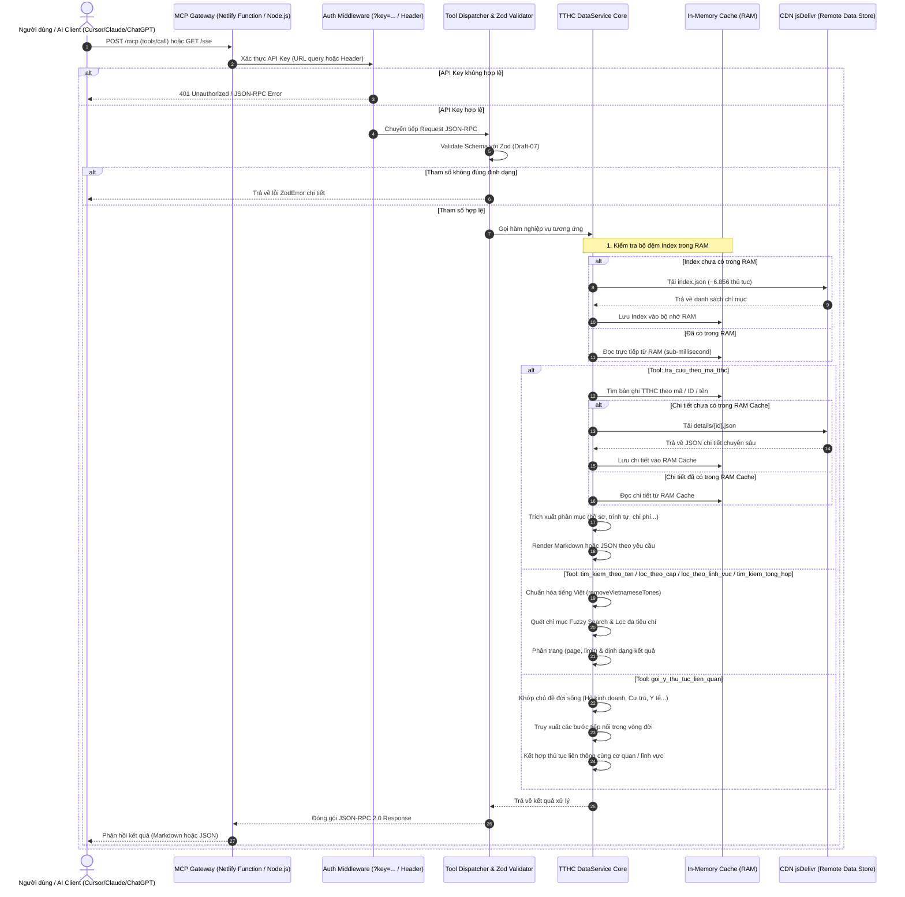
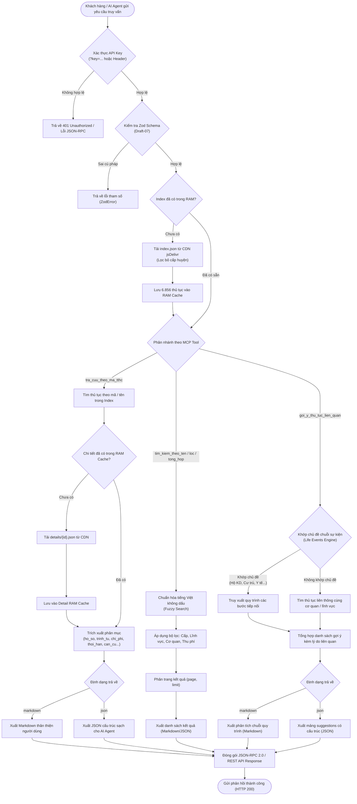

<p align="center">
  
</p>

# MCP Server Thủ Tục Hành Chính Việt Nam (v1.1.0)

> **Phiên bản**: `v1.1.0` | **Tác giả**: **Dev by KynChou** | **Chuẩn MCP**: `2024-11-05` | **OpenAPI**: `3.1.0` | **OpenAI Plugins**: `v1`

[](https://modelcontextprotocol.io)
[](https://www.openapis.org/)
[](https://developers.openai.com/plugins)
[-success.svg)](#kiểm-thử-hệ-thống)
[](https://www.netlify.com)

Ứng dụng **MCP (Model Context Protocol) Server** chuyên dụng phục vụ tra cứu toàn diện cơ sở dữ liệu **Thủ tục Hành chính (TTHC) Việt Nam**, được thiết kế tối ưu cho nền tảng serverless **Netlify Functions** cũng như Node.js Container/Server độc lập. 

Hệ thống cho phép các trợ lý AI hàng đầu như **Claude Desktop, Cursor AI, Windsurf, ChatGPT / Custom GPTs, Copilot, Dify, Coze, n8n** tra cứu trực tiếp toàn bộ dữ liệu thủ tục hành chính, quy trình thực hiện, thành phần hồ sơ, lệ phí, thời hạn giải quyết, căn cứ pháp lý, liên kết Cổng Dịch vụ công Quốc gia và **gợi ý liên thông chuỗi sự kiện đời sống & kinh doanh (Life Events)**.

---

## 📑 Mục Lục
1. [Tính Năng Nổi Bật](#tính-năng-nổi-bật)
2. [Kiến Trúc Hệ Thống & Luồng Dữ Liệu](#kiến-trúc-hệ-thống--luồng-dữ-liệu)
3. [Danh Sách 7 MCP Tools Chuẩn Hóa](#danh-sách-7-mcp-tools-chuẩn-hóa)
4. [Tri Thức Liên Thông Chuỗi Sự Kiện Đời Sống & Kinh Doanh (Life Events)](#tri-thức-liên-thông-chuỗi-sự-kiện-đời-sống--kinh-doanh-life-events)
5. [💡 Các Kịch Bản Sử Dụng Thực Tế (Use Cases)](#-các-kịch-bản-sử-dụng-thực-tế-use-cases)
6. [Chi Tiết JSON Schema Draft-07 Cho Các Tool](#chi-tiết-json-schema-draft-07-cho-các-tool)
7. [Bảo Mật API Key & Cấu Hình Môi Trường](#bảo-mật-api-key--cấu-hình-môi-trường)
8. [Hướng Dẫn Tích Hợp AI Clients (Cursor, Claude, Windsurf, Custom GPTs)](#hướng-dẫn-tích-hợp-ai-clients)
9. [Danh Sách REST API Endpoints](#danh-sách-rest-api-endpoints)
10. [Hướng Dẫn Cài Đặt, Kiểm Thử & Triển Khai](#hướng-dẫn-cài-đặt-kiểm-thử--triển-khai)

---

## Tính Năng Nổi Bật

- **Phiên bản & Đóng gói tiêu chuẩn v1.1.0**: Biên dịch TypeScript sạch 100%, sẵn sàng chạy môi trường Production hoặc triển khai serverless Netlify.
- **Tăng tốc truyền tải CDN toàn cầu**: Tải index và dữ liệu chi tiết qua CDN siêu tốc `cdn.jsdelivr.net` với cơ chế bộ đệm thông minh (In-Memory Cache), phản hồi sub-millisecond cho các truy vấn lặp lại.
- **Hỗ trợ 2 chuẩn giao thức MCP**:
  - **SSE (Server-Sent Events)**: `/sse?key=...` dành cho Cursor AI, Claude Desktop, Windsurf.
  - **Direct HTTP JSON-RPC 2.0**: `/mcp?key=...` (POST) tương thích môi trường serverless không trạng thái.
- **Tương thích 100% OpenAI Plugins & ChatGPT Actions**: Cung cấp sẵn `/.well-known/ai-plugin.json` và `/openapi.json` (OpenAPI 3.1.0) với đầy đủ định nghĩa request/response schemas.
- **Truy xuất chi tiết theo phân mục**: Cho phép tách biệt `ho_so`, `trinh_tu`, `chi_phi`, `thoi_han`, `can_cu_phap_ly`, `yeu_cau_dieu_kien` và lựa chọn định dạng `markdown` (cho người dùng) hoặc `json` (cho AI Agent).
- **Bộ tri thức chuỗi sự kiện đời sống (Life Events Knowledge Base)**: Tự động kết nối chuỗi quy trình liên thông cho **Hộ kinh doanh**, **Cư trú**, **Y tế**, **Sinh con**, **Kết hôn**, **Nhà đất**, **Doanh nghiệp**, **Bằng lái xe**, **Hộ chiếu**, **Khai tử**.
- **Tìm kiếm tiếng Việt thông minh**: Tự động chuẩn hóa dấu tiếng Việt, tìm kiếm mờ (fuzzy search) có dấu hoặc không dấu cực nhanh.
- **Web Dashboard & Interactive Playground**: Giao diện thử nghiệm trực tiếp tại trang chủ, cho phép test tool call, đổi theme, xem tài liệu và sao chép cấu hình chỉ bằng một cú click.

---

## Kiến Trúc Hệ Thống & Luồng Dữ Liệu

### 1. Sơ đồ Tổng Quan Kiến Trúc (System Architecture)



### 2. Sơ đồ Tuần Tự Truy Vấn Dữ Liệu (Data Query Sequence Flow)

Sơ đồ mô tả quy trình tiếp nhận, kiểm tra xác thực, xác thực schema, truy xuất cache RAM và đồng bộ dữ liệu từ CDN:



### 3. Sơ đồ Luồng Phân Nhánh Nghiệp Vụ Truy Vấn (Query Decision Flowchart)

Mô tả thuật toán xử lý phân nhánh giữa các công cụ tra cứu, bóc tách phân mục và gợi ý liên thông:



---

## Danh Sách 7 MCP Tools Chuẩn Hóa

| Tên Tool | Tham số Schema | Mô tả chức năng |
| :--- | :--- | :--- |
| **`tra_cuu_theo_ma_tthc`** | `ma_tthc` *(string, bắt buộc)*<br>`phan_muc` *(enum, tùy chọn: tat_ca, ho_so, trinh_tu, chi_phi, thoi_han, can_cu_phap_ly, yeu_cau_dieu_kien)*<br>`dinh_dang` *(enum, tùy chọn: markdown, json)* | Tra cứu và truy xuất chi tiết chuyên sâu của TTHC theo mã (ví dụ: `6.006781`, `1.117102`) hoặc tên thủ tục. Cho phép trích xuất từng phân mục độc lập và định dạng Markdown hoặc JSON cấu trúc sạch cho AI Agent. |
| **`tim_kiem_theo_ten_tthc`** | `ten_tthc` *(string, bắt buộc)*<br>`limit` *(number, 1-50, mặc định: 10)*<br>`page` *(number, mặc định: 1)* | Tìm kiếm danh sách TTHC theo tên hoặc từ khóa nội dung (hỗ trợ tiếng Việt có dấu hoặc không dấu, ví dụ: *"đăng ký kết hôn"*, *"hộ chiếu"*, *"đất đai"*). |
| **`loc_theo_cap_thuc_hien`** | `cap_thuc_hien` *(string, bắt buộc)*<br>`tu_khoa` *(string, tùy chọn)*<br>`limit` *(number)*<br>`page` *(number)* | Lọc danh sách TTHC theo Cấp thực hiện: `Cấp Bộ`, `Cấp tỉnh`, `Cấp xã`, `Cơ quan khác`. |
| **`loc_theo_linh_vuc`** | `linh_vuc` *(string, bắt buộc)*<br>`tu_khoa` *(string, tùy chọn)*<br>`limit` *(number)*<br>`page` *(number)* | Lọc danh sách TTHC theo Lĩnh vực: `Hộ tịch`, `Kinh doanh`, `Xây dựng`, `Đất đai`, `Thuế`, `Hải quan`, `Đăng kiểm`, v.v. |
| **`tim_kiem_tong_hop`** | `tu_khoa`, `linh_vuc`, `cap_thuc_hien`, `co_quan`, `co_thu_phi`, `limit`, `page` | Tìm kiếm nâng cao kết hợp đa tiêu chí cùng lúc (từ khóa, cấp, lĩnh vực, cơ quan thực hiện/ban hành và trạng thái có thu phí/miễn phí). |
| **`goi_y_thu_tuc_lien_quan`** | `ma_hoac_ten_tthc` *(string, tùy chọn)*<br>`chu_de` *(string, tùy chọn)*<br>`limit` *(number, 1-20, mặc định: 6)*<br>`dinh_dang` *(enum, tùy chọn: markdown, json)* | Gợi ý các thủ tục hành chính liên quan theo chuỗi sự kiện đời sống / kinh doanh (hộ kinh doanh, cư trú, y tế, sinh con, kết hôn, khai tử, chuyển nhượng nhà đất, cấp đổi bằng lái xe, thành lập doanh nghiệp, xuất nhập cảnh, hộ chiếu...) hoặc gợi ý liên thông cùng thủ tục gốc. |
| **`tra_cuu_tthc_gia_lai`**<br>*(alias: `tthc_gia_lai`)* | `tu_khoa`, `ma_tthc`, `cap_thuc_hien`, `co_quan_thuc_hien`, `linh_vuc`, `chi_tiet`, `limit`, `page`, `dinh_dang` | Tra cứu chi tiết các Thủ tục Hành chính thuộc tỉnh Gia Lai. Cơ quan thực hiện: tỉnh Gia Lai, các TTHC cấp tỉnh, cấp xã, các Sở ngành (Sở Xây dựng, Sở Nông nghiệp và Môi trường...), Văn phòng Đăng ký đất đai và Chi nhánh cấp huyện (Pleiku, Chư Sê, Đak Đoa, An Khê, Ayun Pa, Kbang...), Ban Quản lý Khu kinh tế, Chủ tịch UBND tỉnh Gia Lai... Hỗ trợ xuất chi tiết hồ sơ & các bước. |
| **`tra_cuu_tthc_noi_bo`**<br>*(alias: `tthc_noi_bo`)* | `tu_khoa`, `ma_tthc`, `co_quan`, `linh_vuc`, `cap_thuc_hien`, `nhom_noi_bo`, `chi_tiet`, `limit`, `page`, `dinh_dang` | Tra cứu chi tiết các Thủ tục Hành chính nội bộ trong hệ thống hành chính nhà nước (theo Nghị định số 385/2026/NĐ-CP của Chính phủ về kiểm soát thủ tục hành chính). Gồm 2 nhóm: TTHC giữa các cơ quan hành chính nhà nước và TTHC nội bộ trong từng cơ quan. Hỗ trợ xuất chi tiết hồ sơ & các bước. |
| **`tra_cuu_tthc_noi_bo_gia_lai`**<br>*(alias: `tthc_noi_bo_gia_lai`, `tthc_gia_lai_noi_bo`)* | `tu_khoa`, `ma_tthc`, `cap_thuc_hien`, `co_quan`, `linh_vuc`, `nhom_noi_bo`, `chi_tiet`, `limit`, `page`, `dinh_dang` | Tra cứu chuyên sâu các Thủ tục Hành chính Nội bộ thuộc phạm vi tỉnh Gia Lai (cấp tỉnh, cấp xã, UBND tỉnh Gia Lai, Chủ tịch UBND tỉnh, các Sở ban ngành địa phương). Bao gồm TTHC giữa các cơ quan và nội bộ từng cơ quan trên địa bàn Gia Lai theo Nghị định số 385/2026/NĐ-CP. Hỗ trợ xuất chi tiết quy trình & hồ sơ. |
| **`thong_tin_mcp_server`** | *Không yêu cầu* | Trả về thông tin phiên bản máy chủ (`v1.1.0`), tác giả (`Dev by KynChou`), chuẩn giao thức MCP và trạng thái cơ sở dữ liệu quốc gia. |

---

## Tri Thức Liên Thông Chuỗi Sự Kiện Đời Sống & Kinh Doanh (Life Events)

Khi người dân hoặc doanh nghiệp chuẩn bị thực hiện một thủ tục, công cụ `goi_y_thu_tuc_lien_quan` sẽ tự động phân tích ngữ cảnh và tư vấn toàn bộ chuỗi thủ tục liên quan tiếp nối:

### 1. Hộ kinh doanh cá thể (`chu_de: "hộ kinh doanh"`)
* **Bước 1: Thành lập** ➔ `[1.001612]` *Đăng ký thành lập hộ kinh doanh* (UBND cấp xã).
* **Bước 2: Thuế & Thuế khoán** ➔ `[1.011022]` *Khai thuế/Thông báo doanh thu đối với hộ kinh doanh, cá nhân kinh doanh*.
* **Bước 3: Điều kiện ATTP** ➔ `[1.014230]` *Cấp Giấy chứng nhận đủ điều kiện an toàn thực phẩm cơ sở sản xuất, kinh doanh*.
* **Bước 4: Thay đổi nội dung** ➔ `[2.000720]` *Đăng ký thay đổi nội dung đăng ký hộ kinh doanh* (ngành nghề, địa chỉ, người đại diện).
* **Bước 5: Tạm ngừng kinh doanh** ➔ `[1.001570]` *Tạm ngừng kinh doanh, tiếp tục kinh doanh trước thời hạn của hộ kinh doanh*.
* **Bước 6: Chấm dứt hoạt động** ➔ `[1.001266]` *Chấm dứt hoạt động hộ kinh doanh* (đóng mã số thuế, giải thể).
* **Bước 7: Chuyển đổi mô hình** ➔ `[2.001999]` *Hỗ trợ tư vấn, hướng dẫn hồ sơ chuyển đổi hộ kinh doanh thành doanh nghiệp*.

### 2. Cư trú & Chỗ ở (`chu_de: "cư trú"`)
* **Bước 1: Nhập khẩu chỗ ở mới** ➔ `[1.116788]` *Đăng ký thường trú* (Cấp xã).
* **Bước 2: Tạm trú khi thuê nhà/ở trọ** ➔ `[1.116789]` *Đăng ký tạm trú* (Cấp xã).
* **Bước 3: Xác nhận cư trú** ➔ `[1.010041]` *Xác nhận thông tin về cư trú (Mẫu CT07 thay thế sổ hộ khẩu giấy)*.
* **Bước 4: Khai báo tạm vắng** ➔ `[1.003677]` *Khai báo tạm vắng khi rời khỏi nơi cư trú*.
* **Bước 5: Căn cước công dân** ➔ `[1.116414]` *Thu thập, cập nhật thông tin và cấp chứng nhận căn cước*.
* **Bước 6: Xóa đăng ký thường trú** ➔ `[2.002913]` *Liên thông điện tử: Khai tử, xóa đăng ký thường trú, mai táng phí, tử tuất*.

### 3. Y tế & Chăm sóc sức khỏe (`chu_de: "y tế"`)
* **Bước 1: Bảo hiểm y tế (BHYT)** ➔ `[1.116466]` *Giám định chi phí khám bệnh, chữa bệnh BHYT* & `[3.000722]` *Cấp thẻ BHYT trẻ em*.
* **Bước 2: Kỹ thuật chuyên môn** ➔ `[1.117101]` *Cho phép cơ sở khám bệnh, chữa bệnh áp dụng kỹ thuật loại đặc biệt*.
* **Bước 3: Giấy phép hành nghề y** ➔ `[1.117100]` *Thừa nhận giấy phép hành nghề khám bệnh, chữa bệnh tại Việt Nam* & `[1.012291]` *Gia hạn giấy phép*.
* **Bước 4: Kinh doanh dược phẩm** ➔ `[2.002315]` *Cấp Giấy chứng nhận đủ điều kiện kinh doanh dược*.
* **Bước 5: Khám sức khỏe** ➔ `[1.012281]` *Công bố cơ sở đủ điều kiện khám sức khỏe (học tập, làm việc, lái xe)*.
* **Bước 6: Tiêm chủng** ➔ `[2.000655]` *Công bố cơ sở đủ điều kiện tiêm chủng vắc xin*.

### 4. Các chuỗi sự kiện đời sống thiết yếu khác:
* **Sinh con & Trẻ em**: Đăng ký khai sinh ➔ Đăng ký thường trú ➔ Cấp thẻ BHYT ➔ Trợ cấp thai sản ➔ Hộ chiếu trẻ em.
* **Kết hôn & Hôn nhân**: Giấy xác nhận tình trạng hôn nhân ➔ Đăng ký kết hôn ➔ Đăng ký biến động tài sản chung đất đai.
* **Mua bán, chuyển nhượng nhà đất**: Đăng ký biến động quyền sử dụng đất ➔ Cấp đổi Sổ đỏ/Sổ hồng ➔ Đăng ký thế chấp ngân hàng ➔ Giấy phép xây dựng.
* **Thành lập doanh nghiệp**: Đăng ký thành lập công ty ➔ Khai thuế môn bài & mã số thuế ➔ Giấy chứng nhận ATTP ➔ PCCC.
* **Phương tiện & Lái xe**: Đổi/cấp lại giấy phép lái xe ➔ Đăng ký cấp biển số xe ➔ Kiểm định an toàn kỹ thuật (đăng kiểm).
* **Hộ chiếu & Xuất nhập cảnh**: Cấp hộ chiếu phổ thông toàn trình ➔ Cấp lại hộ chiếu hư hỏng/mất ➔ Khai báo tạm trú người nước ngoài.
* **Khai tử & Chế độ tử tuất**: Đăng ký khai tử ➔ Xóa thường trú ➔ Hưởng trợ cấp mai táng phí ➔ Giải quyết chế độ tử tuất.

---

## 💡 Các Kịch Bản Sử Dụng Thực Tế (Use Cases)

### Kịch bản 1: Tra cứu chi tiết hồ sơ & các bước thực hiện của thủ tục
* **Câu hỏi của người dân**: *"Tôi muốn biết chi tiết thành phần hồ sơ và các bước làm thủ tục Đăng ký kết hôn"*
* **Cách AI gọi tool**:
```json
{
  "name": "tra_cuu_theo_ma_tthc",
  "arguments": {
    "ma_tthc": "Đăng ký kết hôn",
    "phan_muc": "ho_so",
    "dinh_dang": "markdown"
  }
}
```

### Kịch bản 2: AI Agent xử lý logic cần dữ liệu chi tiết dạng JSON
* **Yêu cầu của Agent**: *"Trích xuất dữ liệu chi phí và thời hạn giải quyết của thủ tục 6.006781 dạng JSON sạch"*
* **Cách AI gọi tool**:
```json
{
  "name": "tra_cuu_theo_ma_tthc",
  "arguments": {
    "ma_tthc": "6.006781",
    "phan_muc": "chi_phi",
    "dinh_dang": "json"
  }
}
```

### Kịch bản 3: Tìm kiếm thủ tục nhanh theo tên hoặc từ khóa
* **Câu hỏi của người dân**: *"Tìm các thủ tục cấp đổi bằng lái xe hoặc giấy phép lái xe"*
* **Cách AI gọi tool**:
```json
{
  "name": "tim_kiem_theo_ten_tthc",
  "arguments": {
    "ten_tthc": "đổi giấy phép lái xe",
    "limit": 5,
    "page": 1
  }
}
```

### Kịch bản 4: Lọc thủ tục theo Cấp thực hiện và Lĩnh vực
* **Câu hỏi của người dân**: *"Liệt kê các thủ tục về đất đai thực hiện ở Cấp xã"*
* **Cách AI gọi tool**:
```json
{
  "name": "loc_theo_cap_thuc_hien",
  "arguments": {
    "cap_thuc_hien": "Cấp xã",
    "tu_khoa": "đất đai",
    "limit": 6
  }
}
```

### Kịch bản 5: Tìm kiếm tổng hợp đa tiêu chí (Lĩnh vực + Cơ quan + Miễn phí)
* **Câu hỏi của người dân**: *"Tìm thủ tục thuộc Bộ Tài chính, lĩnh vực Thuế và không thu phí"*
* **Cách AI gọi tool**:
```json
{
  "name": "tim_kiem_tong_hop",
  "arguments": {
    "co_quan": "Bộ Tài chính",
    "linh_vuc": "Thuế",
    "co_thu_phi": false,
    "limit": 10
  }
}
```

### Kịch bản 6: Gợi ý chuỗi sự kiện mở Hộ kinh doanh cá thể
* **Câu hỏi của người dân**: *"Tôi sắp mở quán ăn kinh doanh cá thể thì cần làm những thủ tục hành chính nào?"*
* **Cách AI gọi tool**:
```json
{
  "name": "goi_y_thu_tuc_lien_quan",
  "arguments": {
    "chu_de": "hộ kinh doanh",
    "limit": 6,
    "dinh_dang": "markdown"
  }
}
```

### Kịch bản 7: Kiểm tra tình trạng kết nối & số liệu hệ thống
* **Câu hỏi của người dân**: *"Hệ thống MCP này đang kết nối đến đâu và có bao nhiêu thủ tục hành chính?"*
* **Cách AI gọi tool**:
```json
{
  "name": "thong_tin_mcp_server",
  "arguments": {}
}
```

---

## Chi Tiết JSON Schema Draft-07 Cho Các Tool

Mọi tool call đều tuân thủ nghiêm ngặt chuẩn **JSON Schema Draft-07**, giúp các client AI (Claude, Cursor, OpenAI, Windsurf) sinh tham số chuẩn xác 100%:

### 1. `tra_cuu_theo_ma_tthc`
```json
{
  "$schema": "http://json-schema.org/draft-07/schema#",
  "type": "object",
  "required": ["ma_tthc"],
  "properties": {
    "ma_tthc": {
      "type": "string",
      "description": "Mã TTHC (ví dụ: '6.006781', '1.117102'), ID hệ thống hoặc tên thủ tục"
    },
    "phan_muc": {
      "type": "string",
      "enum": ["tat_ca", "ho_so", "trinh_tu", "chi_phi", "thoi_han", "can_cu_phap_ly", "yeu_cau_dieu_kien"],
      "default": "tat_ca",
      "description": "Phân mục chi tiết cụ thể cần trích xuất"
    },
    "dinh_dang": {
      "type": "string",
      "enum": ["markdown", "json"],
      "default": "markdown",
      "description": "Định dạng kết quả trả về: 'markdown' hoặc 'json'"
    }
  },
  "additionalProperties": false
}
```

### 2. `tim_kiem_theo_ten_tthc`
```json
{
  "$schema": "http://json-schema.org/draft-07/schema#",
  "type": "object",
  "required": ["ten_tthc"],
  "properties": {
    "ten_tthc": {
      "type": "string",
      "description": "Tên thủ tục hoặc từ khóa tìm kiếm (hỗ trợ có dấu và không dấu)"
    },
    "limit": { "type": "integer", "minimum": 1, "maximum": 50, "default": 10 },
    "page": { "type": "integer", "minimum": 1, "default": 1 }
  },
  "additionalProperties": false
}
```

### 3. `loc_theo_cap_thuc_hien`
```json
{
  "$schema": "http://json-schema.org/draft-07/schema#",
  "type": "object",
  "required": ["cap_thuc_hien"],
  "properties": {
    "cap_thuc_hien": {
      "type": "string",
      "description": "Cấp thực hiện cần lọc ('Cấp Bộ', 'Cấp tỉnh', 'Cấp xã', 'Cơ quan khác')"
    },
    "tu_khoa": { "type": "string", "description": "Từ khóa tìm kiếm bổ sung trong danh sách lọc" },
    "limit": { "type": "integer", "minimum": 1, "maximum": 50, "default": 10 },
    "page": { "type": "integer", "minimum": 1, "default": 1 }
  },
  "additionalProperties": false
}
```

### 4. `loc_theo_linh_vuc`
```json
{
  "$schema": "http://json-schema.org/draft-07/schema#",
  "type": "object",
  "required": ["linh_vuc"],
  "properties": {
    "linh_vuc": {
      "type": "string",
      "description": "Tên lĩnh vực cần lọc (ví dụ: 'Hộ tịch', 'Kinh doanh', 'Xây dựng', 'Đất đai', 'Thuế')"
    },
    "tu_khoa": { "type": "string", "description": "Từ khóa tìm kiếm bổ sung trong lĩnh vực" },
    "limit": { "type": "integer", "minimum": 1, "maximum": 50, "default": 10 },
    "page": { "type": "integer", "minimum": 1, "default": 1 }
  },
  "additionalProperties": false
}
```

### 5. `tim_kiem_tong_hop`
```json
{
  "$schema": "http://json-schema.org/draft-07/schema#",
  "type": "object",
  "properties": {
    "tu_khoa": { "type": "string", "description": "Từ khóa tên thủ tục hoặc nội dung cần tìm" },
    "linh_vuc": { "type": "string", "description": "Lĩnh vực cần lọc" },
    "cap_thuc_hien": { "type": "string", "description": "Cấp thực hiện cần lọc" },
    "co_quan": { "type": "string", "description": "Cơ quan thực hiện hoặc ban hành" },
    "co_thu_phi": { "type": "boolean", "description": "true: có phí, false: miễn phí" },
    "limit": { "type": "integer", "minimum": 1, "maximum": 50, "default": 10 },
    "page": { "type": "integer", "minimum": 1, "default": 1 }
  },
  "additionalProperties": false
}
```

### 6. `goi_y_thu_tuc_lien_quan`
```json
{
  "$schema": "http://json-schema.org/draft-07/schema#",
  "type": "object",
  "properties": {
    "ma_hoac_ten_tthc": {
      "type": "string",
      "description": "Mã TTHC hoặc tên thủ tục gốc đang xem xét (tùy chọn)"
    },
    "chu_de": {
      "type": "string",
      "description": "Chủ đề sự kiện: 'hộ kinh doanh', 'cư trú', 'y tế', 'sinh con', 'kết hôn', 'mua bán nhà đất', 'thành lập doanh nghiệp'..."
    },
    "limit": { "type": "integer", "minimum": 1, "maximum": 20, "default": 6 },
    "dinh_dang": {
      "type": "string",
      "enum": ["markdown", "json"],
      "default": "markdown",
      "description": "Định dạng kết quả trả về"
    }
  },
  "additionalProperties": false
}
```

### 7. `thong_tin_mcp_server`
```json
{
  "$schema": "http://json-schema.org/draft-07/schema#",
  "type": "object",
  "properties": {},
  "additionalProperties": false
}
```

### 8. `tra_cuu_tthc_gia_lai` *(alias: `tthc_gia_lai`)*
```json
{
  "$schema": "http://json-schema.org/draft-07/schema#",
  "type": "object",
  "properties": {
    "tu_khoa": { "type": "string", "description": "Từ khóa tìm kiếm TTHC tỉnh Gia Lai" },
    "ma_tthc": { "type": "string", "description": "Mã TTHC cụ thể thuộc tỉnh Gia Lai nếu muốn truy xuất ngay chi tiết chuyên sâu" },
    "cap_thuc_hien": {
      "type": "string",
      "enum": ["tat_ca", "cap_tinh", "cap_xa", "cap_xa_va_tinh"],
      "default": "tat_ca",
      "description": "Lọc theo cấp thực hiện tại Gia Lai"
    },
    "co_quan_thuc_hien": { "type": "string", "description": "Lọc theo cơ quan (Sở ngành, Chi nhánh VPĐKĐĐ, UBND cấp xã, Chủ tịch UBND...)" },
    "linh_vuc": { "type": "string", "description": "Lọc theo lĩnh vực" },
    "chi_tiet": { "type": "boolean", "default": false, "description": "true: trích xuất toàn bộ hồ sơ, các bước quy trình, phí, căn cứ pháp lý" },
    "limit": { "type": "integer", "minimum": 1, "maximum": 50, "default": 10 },
    "page": { "type": "integer", "minimum": 1, "default": 1 },
    "dinh_dang": { "type": "string", "enum": ["markdown", "json"], "default": "markdown" }
  },
  "additionalProperties": false
}
```

### 9. `tra_cuu_tthc_noi_bo` *(alias: `tthc_noi_bo`)*
```json
{
  "$schema": "http://json-schema.org/draft-07/schema#",
  "type": "object",
  "properties": {
    "tu_khoa": { "type": "string", "description": "Từ khóa tìm kiếm TTHC nội bộ (theo tên, mã, nội dung nghiệp vụ)" },
    "ma_tthc": { "type": "string", "description": "Mã TTHC nội bộ cụ thể nếu muốn truy xuất ngay chi tiết chuyên sâu" },
    "co_quan": { "type": "string", "description": "Cơ quan thực hiện hoặc công bố (Bộ Nội vụ, Bộ Công thương, UBND tỉnh...)" },
    "linh_vuc": { "type": "string", "description": "Lĩnh vực nghiệp vụ nội bộ (Địa chất khoáng sản, Thi đua khen thưởng, Công chức...)" },
    "cap_thuc_hien": {
      "type": "string",
      "enum": ["tat_ca", "cap_bo", "cap_tinh", "cap_xa"],
      "default": "tat_ca",
      "description": "Lọc theo cấp thực hiện"
    },
    "nhom_noi_bo": {
      "type": "string",
      "enum": ["tat_ca", "giua_cac_co_quan", "trong_noi_bo"],
      "default": "tat_ca",
      "description": "Phân nhóm theo Nghị định số 385/2026/NĐ-CP của Chính phủ về kiểm soát thủ tục hành chính: giữa các cơ quan hành chính nhà nước hoặc nội bộ từng cơ quan"
    },
    "chi_tiet": { "type": "boolean", "default": false, "description": "true: trích xuất toàn bộ hồ sơ, các bước quy trình, phí, căn cứ pháp lý" },
    "limit": { "type": "integer", "minimum": 1, "maximum": 50, "default": 10 },
    "page": { "type": "integer", "minimum": 1, "default": 1 },
    "dinh_dang": { "type": "string", "enum": ["markdown", "json"], "default": "markdown" }
  },
  "additionalProperties": false
}
```

---

## Bảo Mật Khóa API Chia Sẻ (Shared API Key) & Cấu Hình Môi Trường

Hệ thống hỗ trợ kiểm soát quyền truy cập linh hoạt qua biến môi trường `API_KEY` (khóa đơn) hoặc `MCP_API_KEYS` (danh sách nhiều khóa chia sẻ cho từng đối tác):

### 1. Cấu hình biến môi trường:
* **Khóa đơn lẻ (Single Key)**:
  ```env
  API_KEY=sk_tthc_production_secret
  ```
* **Nhiều khóa chia sẻ theo đối tác (Multi-Key Shared)**:
  ```env
  MCP_API_KEYS=openai:sk_openai_live_123,dify:sk_dify_live_456,cursorteam:sk_cursor_789
  ```
  *(Mỗi khóa có thể gán nhãn `nhan:key` để dễ dàng quản trị, theo dõi lưu lượng và thu hồi độc lập)*

### 2. Ba hình thức gửi khóa từ Client:
1. **HTTP Bearer Header (Khuyên dùng cho OpenAI Plugin / Codex / Responses API)**:
   ```http
   Authorization: Bearer <YOUR_API_KEY>
   ```
2. **HTTP Custom Header (Khuyên dùng cho Custom GPT Actions, Dify, Postman, n8n)**:
   ```http
   X-API-Key: <YOUR_API_KEY>
   ```
3. **URL Query Parameter (Dành cho SSE Clients hoặc URL kết nối đơn giản)**:
   ```text
   https://<your-site>.netlify.app/sse?key=<YOUR_API_KEY>
   hoặc
   https://<your-site>.netlify.app/mcp?key=<YOUR_API_KEY>
   ```

> **Lưu ý**: Nếu cả `API_KEY` và `MCP_API_KEYS` đều để trống, máy chủ sẽ tự động hoạt động ở chế độ mở (Open / Development Mode).

---

## Hướng Dẫn Tích Hợp AI Clients

### 1. Cursor AI
Tạo hoặc mở file `.cursor/mcp.json` trong dự án của bạn:
```json
{
  "mcpServers": {
    "tthc-vietnam": {
      "url": "https://<your-site>.netlify.app/sse?key=YOUR_SECRET_API_KEY"
    }
  }
}
```

### 2. Claude Desktop
Chỉnh sửa file `claude_desktop_config.json` (`~/Library/Application Support/Claude/claude_desktop_config.json` trên macOS hoặc `%APPDATA%\Claude\claude_desktop_config.json` trên Windows):
```json
{
  "mcpServers": {
    "tthc-vietnam": {
      "url": "https://<your-site>.netlify.app/sse?key=YOUR_SECRET_API_KEY"
    }
  }
}
```

### 3. Windsurf IDE
Thêm vào file cấu hình `~/.codeium/windsurf/mcp_config.json`:
```json
{
  "mcpServers": {
    "tthc-vietnam": {
      "serverUrl": "https://<your-site>.netlify.app/sse?key=YOUR_SECRET_API_KEY"
    }
  }
}
```

### 4. OpenAI Agent Plugins (Chuẩn mới Agent Plugins Specification 1.0.0)
Máy chủ đã tự động sinh các tệp manifest chuẩn hóa:
* **Plugin Manifest**: `https://<your-site>.netlify.app/plugin.json`
* **MCP Server Config**: `https://<your-site>.netlify.app/mcp.json`

File `mcp.json` cấu hình phương thức xác thực `api_key` với headerScheme `bearer`:
```json
{
  "$schema": "https://agent-plugins.org/schemas/1.0.0/mcp.schema.json",
  "mcpServers": {
    "tthc-dvcqg": {
      "type": "streamable-http",
      "url": "https://<your-site>.netlify.app/mcp",
      "extensions": {
        "com.openai": {
          "auth": {
            "type": "api_key",
            "headerScheme": "bearer"
          }
        }
      }
    }
  }
}
```
Khi người dùng cài đặt Plugin qua ChatGPT / OpenAI Agent, họ chỉ cần nhập API Key chia sẻ một lần; OpenAI sẽ tự động gắn header `Authorization: Bearer <key>` vào mọi cuộc gọi MCP tool.

### 5. OpenAI Codex Plugins (.codex-plugin)
Trong môi trường OpenAI Codex CLI / Desktop, token được truyền an toàn qua biến môi trường thông qua cấu hình `.mcp.json`:
```json
{
  "mcpServers": {
    "tthc_dvcqg": {
      "type": "http",
      "url": "https://<your-site>.netlify.app/mcp",
      "bearer_token_env_var": "MCP_TTHC_API_KEY"
    }
  }
}
```
Client chỉ cần export biến trong shell trước khi khởi chạy:
```bash
export MCP_TTHC_API_KEY="YOUR_SHARED_KEY"
```

### 6. Custom GPT Actions (ChatGPT)
Server tương thích 100% với chuẩn [OpenAPI 3.1.0 Actions](https://platform.openai.com/docs/actions):
* **OpenAPI 3.1 Schema URL**: `https://<your-site>.netlify.app/openapi.json`
* **Classic Plugin Manifest**: `https://<your-site>.netlify.app/.well-known/ai-plugin.json`

**Các bước cấu hình Custom GPT Actions**:
1. Vào phần cấu hình Custom GPT -> chọn **Configure** -> **Create new action**.
2. Tại ô **Import from URL**, dán: `https://<your-site>.netlify.app/openapi.json` -> Nhấn **Import**.
3. Tại mục **Authentication**: Chọn **API Key**, Auth Type chọn **Bearer** (hoặc Custom Header `X-API-Key`), điền API Key chia sẻ.
4. Toàn bộ các công cụ tra cứu TTHC sẽ được nhận diện và tự động liên kết!

### 7. Hai Tool `search` & `fetch` Chuẩn Hóa Cho OpenAI Deep Research / Connectors
* **`search`**: Nhận `{ query: string }`, trả về danh sách tài liệu tóm tắt `[{ id, title, url }]`.
* **`fetch`**: Nhận `{ id: string }`, truy xuất toàn văn nội dung Markdown và metadata chi tiết của thủ tục.

### 8. Test Trực Tiếp Bằng cURL với Bearer Token (Direct JSON-RPC 2.0)
```bash
curl -X POST "https://<your-site>.netlify.app/mcp" \
  -H "Authorization: Bearer YOUR_SECRET_API_KEY" \
  -H "Content-Type: application/json" \
  -d '{
    "jsonrpc": "2.0",
    "id": 1,
    "method": "tools/call",
    "params": {
      "name": "search",
      "arguments": {
        "query": "đăng ký kết hôn"
      }
    }
  }'
```


---

## Danh Sách REST API Endpoints

Hệ thống cung cấp song song giao diện REST API chuẩn cho các nền tảng Web, App di động, n8n, Dify và Postman:

| Endpoint | Method | Tham số chính | Mô tả |
| :--- | :---: | :--- | :--- |
| `/api/tthc/search` | `GET` | `q`, `limit`, `page` | Tìm kiếm thủ tục theo tên / từ khóa |
| `/api/tthc/detail` | `GET` | `ma_tthc`, `phan_muc`, `dinh_dang` | Truy xuất chi tiết TTHC theo phân mục và định dạng |
| `/api/tthc/related` | `GET`, `POST` | `ma_tthc`, `chu_de`, `limit`, `dinh_dang` | Gợi ý thủ tục theo chuỗi sự kiện đời sống & kinh doanh |
| `/api/tthc/cap` | `GET` | `cap`, `q`, `limit`, `page` | Lọc thủ tục theo Cấp thực hiện |
| `/api/tthc/linhvuc` | `GET` | `linhvuc`, `q`, `limit`, `page` | Lọc thủ tục theo Lĩnh vực |
| `/api/tthc/coquan` | `GET` | `co_quan`, `q`, `limit`, `page` | Lọc thủ tục theo Cơ quan thực hiện |
| `/api/tthc/advanced`| `GET`, `POST` | `q`, `linhvuc`, `cap`, `co_quan`, `co_thu_phi`, `limit`, `page` | Tìm kiếm tổng hợp kết hợp đa tiêu chí |
| `/api/tthc/stats` | `GET` | *Không* | Lấy số liệu thống kê tổng hợp CSDL Quốc gia |
| `/openapi.json` | `GET` | *Không* | Đặc tả kỹ thuật OpenAPI 3.1.0 đầy đủ |
| `/.well-known/ai-plugin.json` | `GET` | *Không* | Manifest cấu hình cho OpenAI Plugins |

---

## Hướng Dẫn Cài Đặt, Kiểm Thử & Triển Khai

### 1. Cài Đặt Thư Viện Cục Bộ
```bash
npm install
```

### 2. Kiểm Thử Hệ Thống (Automated Test Suite)
Bộ test tự động kiểm tra toàn diện 17 kịch bản từ xác thực, tải dữ liệu CDN, 7 tool calls, xử lý lỗi 405 đến các REST API:
```bash
npm test
```
*Kết quả mong đợi: `[SUCCESS] TẤT CẢ 17 TEST ĐÃ HOÀN THÀNH XUẤT SẮC 100%!`*

### 3. Chạy Môi Trường Phát Triển Cục Bộ
```bash
npm run dev
```
Mở trình duyệt tại `http://localhost:3000` để truy cập Web Dashboard & Playground.

### 4. Đóng Gói Build Production & Tệp ZIP
```bash
# Biên dịch TypeScript sang thư mục dist/
npm run build

# Đóng gói tự động cả 2 file ZIP sản phẩm
npm run zip
```
Lệnh trên sẽ tự động tạo ra 2 gói triển khai tại `dist/`:
1. `dist/mcp-tthc-v1.1.0-build.zip`: Gói chạy độc lập Node.js (Giải nén -> `npm install --omit=dev` -> `npm start`).
2. `dist/mcp-tthc-netlify-v1.1.0-netlify.zip`: Gói chuyên dụng deploy Netlify.

### 5. Hướng Dẫn Triển Khai Lên Netlify

#### Cách A: Triển Khai Thủ Công Bằng Netlify Drop (Nhanh nhất - Không cần Git)
1. Chạy lệnh: `npm run zip`.
2. Truy cập [app.netlify.com/drop](https://app.netlify.com/drop).
3. Kéo thả file `dist/mcp-tthc-netlify-v1.1.0-netlify.zip` hoặc thư mục `dist/netlify-deploy` vào trang.
4. Dự án sẽ lập tức online với đầy đủ Web UI, Serverless Function và các Endpoint MCP!

#### Cách B: Triển Khai Qua Git CI/CD Tự Động
1. Đẩy mã nguồn lên repository GitHub / GitLab.
2. Trên Netlify Dashboard, chọn **Add new site** > **Import an existing project**.
3. Cấu hình build (đã cấu hình sẵn trong `netlify.toml`):
   - **Build command**: `npm run build:netlify`
   - **Publish directory**: `public`
   - **Functions directory**: `netlify/functions`
4. Cài đặt biến môi trường:
   - `API_KEY`: *(Mã khóa bí mật của bạn, tùy chọn)*
   - `NODE_VERSION`: `20`

---

## Bản Quyền & Tác Giả

- **Phát triển bởi**: **Dev by KynChou**
- **Liên hệ / Hỗ trợ**: [info@dnncloud.net](mailto:info@dnncloud.net)
- **Nguồn dữ liệu**: Dữ liệu công khai từ Cổng Dịch vụ công Quốc gia Việt Nam.
